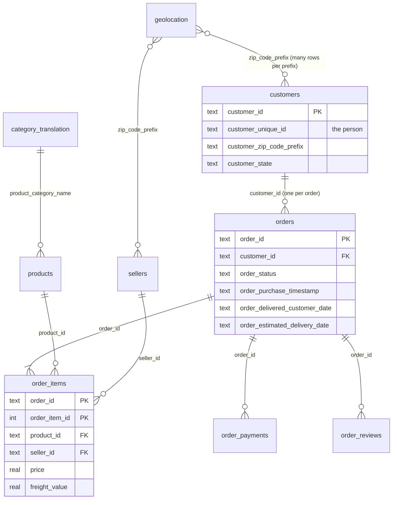

# Olist e-commerce analytics

SQL analysis, a Power BI dashboard for an operations manager, and a late-delivery model on the [Olist Brazilian e-commerce dataset](https://www.kaggle.com/datasets/olistbr/brazilian-ecommerce) (~100k orders, 2016–2018, nine tables).

**Stack:** SQLite · SQL (CTEs, window functions) · Python · pandas · scikit-learn · LightGBM · Power BI (DAX)

<!-- After the dashboard is built:


-->

## Top findings
1. **Lateness drives bad reviews.** 6.8% of delivered orders arrive late. Those average **2.27★ vs 4.29★** on time, and **62%** of them get 1–2★ (vs 9%). Even 1–3 days late drops the average to 3.29★.
2. **Two lanes produce 40% of late orders.** SP→RJ is 8.5% of deliveries but 17.6% of late orders (14.1% late rate, 3× SP→SP). Late orders spend 28 days with the carrier vs 8 for on-time ones, and 28% of them missed the seller's shipping limit.
3. **The promise matters more than the distance.** When the checkout estimate is shorter than the lane's recent delivery time, 22% of orders arrive late, vs 3% with 15+ days of slack. Orders with under 5 days of slack are 18% of volume and 34% of late orders.

Also: growth is volume, not basket size (orders 2.4× YoY, AOV flat at 125–153 BRL), and monthly revenue has been flat since Jan 2018. Only 2.2% of customers ever buy again on a different day.

Full write-up: [`reports/insights.md`](reports/insights.md).

## Model: will this order arrive late?
**Main test:** purchases 2018-06-21 → 2018-08-29 (14,485 orders, 4.28% late). The final models are refit on train+validation. The flag rate is chosen on validation to reach 50% recall, then applied unchanged to test.

| Model | PR-AUC | ROC-AUC | Orders flagged | Recall | Precision |
|---|---|---|---|---|---|
| Base rate (no model) | 0.043 | 0.50 | – | – | – |
| Logistic regression | 0.067 | 0.57 | 18.7% | 26.0% | 6.0% |
| Gradient boosting | 0.064 | 0.62 | 19.1% | 30.8% | 6.9% |

**Rolling backtest** (`src/backtest.py`): the same protocol on four consecutive two-month windows.

| Test window | Late rate | GBM PR-AUC | Lift vs base | GBM ROC-AUC |
|---|---|---|---|---|
| 2017-12 → 2018-01 | 6.5% | 0.164 | 2.5× | 0.70 |
| 2018-02 → 2018-03 | 16.6% | 0.299 | 1.8× | 0.69 |
| 2018-04 → 2018-05 | 5.5% | 0.137 | 2.5× | 0.74 |
| 2018-06 → 2018-08 | 3.6% | 0.066 | 1.8× | 0.66 |


- **Target:** delivered on a later calendar date than the estimate shown at checkout.
- **Features known at order time only:** promised delivery days, **slack** (promise minus the lane's mean delivery time over the previous 60 days), basket size/weight/volume, price and freight, seller–customer distance and states, payment type/instalments, purchase time, and seller/lane/network late-rate history. All history is built only from orders **already delivered before the purchase**. Post-purchase fields (approval, carrier hand-over, delivery dates, status, reviews) are never used. `tests/test_leakage.py` recomputes the seller and route history by brute force and checks it matches.
- **Why the scores move:** in mid-2018 Olist cut its average promise from ~28 to ~15 days. That reversed the direction of several geography features (distance and freight predicted lateness in 2017, but not in Jul–Aug 2018). A random split hides this drift and reports ROC-AUC 0.81, which is why the split is by date. Slack is the top feature and the only one whose direction never flipped.
- **Use:** a ranking aid for proactive customer messages and seller follow-up, retrained monthly. The bigger operational win needs no model: don't issue promises shorter than the lane's recent delivery time plus a buffer.

## Run it
```bash
pip install -r requirements.txt
# put the nine Kaggle CSVs in data/raw/
python src/etl.py                 # fresh data/olist.db from sql/01_schema.sql + CSVs
python src/run_sql.py             # runs sql/02..06 top to bottom -> reports/sql_outputs/*.csv
python src/features.py            # -> data/features.csv
python tests/test_leakage.py      # leakage checks
python src/train.py               # -> reports/model_metrics.json, figures, models/gbm.pkl
python src/backtest.py            # -> reports/backtest.csv, reports/figures/backtest.png
python src/export_powerbi.py      # -> dashboard/data/*.csv for Power BI
```
Or `make all`. No Kaggle data yet? `make smoke` runs the whole pipeline on synthetic Olist-shaped data (fake numbers, for testing code only).

## Data
| Table | Rows |
|---|---|
| customers | 99,441 |
| geolocation | 1,000,163 |
| sellers | 3,095 |
| products | 32,951 |
| category_translation | 71 |
| orders | 99,441 |
| order_items | 112,650 |
| order_payments | 103,886 |
| order_reviews | 99,224 |

From `reports/sql_outputs/dq_row_counts.csv`.



**Gotchas handled**
- `customer_id` is new for every order; repeat-purchase analysis uses `customer_unique_id`.
- `review_id` is not unique and some orders have several reviews → `v_order_reviews` keeps the latest per order.
- Geolocation has many rows per zip prefix and some points outside Brazil → averaged per prefix within Brazil's bounding box.
- Zip prefixes lose leading zeros in the CSVs → zero-padded to 5 characters on load.
- First and last months are sparse → trends use 2017-01 → 2018-08.

## Repo layout
```
sql/          01_schema … 06_delivery_delay   (each query tagged "-- @name")
src/          etl.py, run_sql.py, features.py, train.py, backtest.py, export_powerbi.py
notebooks/    01_eda.ipynb, 02_delivery_model.ipynb
dashboard/    README.md (data model, DAX, page spec), olist.pbix, screenshots/
reports/      insights.md, sql_outputs/, figures/, model_metrics.json, backtest.csv
tests/        test_leakage.py, make_synthetic_data.py
```

## Limitations
- Orders still in transit at the data snapshot are excluded from the model; they skew late, so the final weeks look more on-time than they were.
- The late rate drifts month to month (1%–19%), and model quality depends on the window (see backtest).
- `promised_days` is a legitimate checkout-time feature, but it means the model partly learns Olist's own estimation error.
- Distances use zip-prefix centroids, not addresses.
- Public sample of Olist's marketplace; no costs or margins, so impact is stated in reviews and late orders, not money.

## Resume bullet
> Analysed 99k Olist orders in SQL (CTEs, window functions) and built a 3-page Power BI dashboard on revenue growth, delivery performance and seller/category KPIs; found two shipping lanes cause 40% of late deliveries, and that late orders average 2.3★ vs 4.3★. Trained a gradient-boosting model to predict late delivery from checkout-time features, reaching PR-AUC 1.8–2.5× the base rate across a four-window time-based backtest, with a leakage test on point-in-time features.
